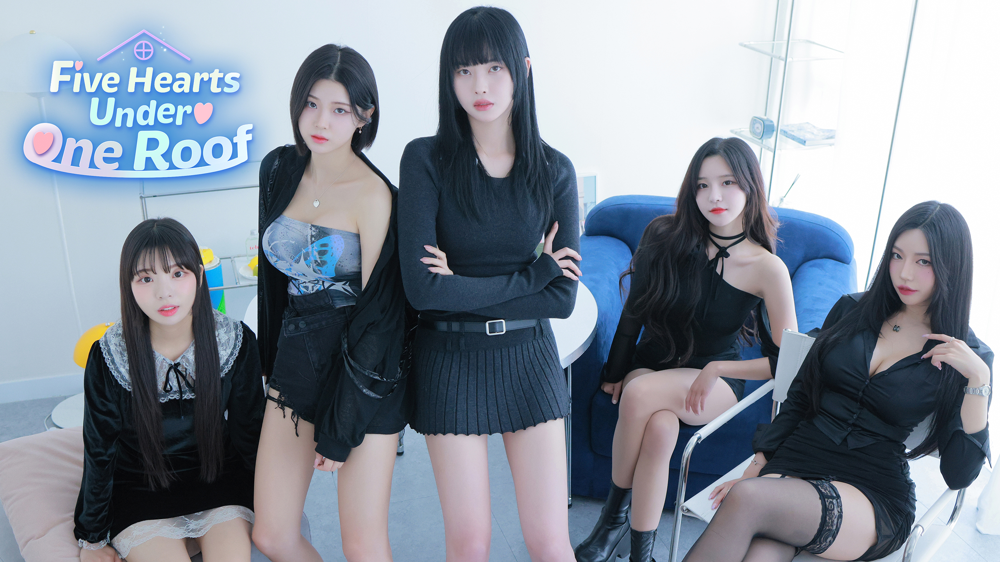

# Five Hearts Under One Roof 1 (MilkGame) — Persian Subtitle Mod

<div align="center">



### پچ زیرنویس فارسی کامل، محاوره‌ای و اختصاصی بازی «Five Hearts Under One Roof 1» برای سیستم‌عامل macOS

[](https://github.com/EhsanShahbazii/five-hearts-under-one-roof-persian-mod/releases)
[](https://ehsanshahbazii.github.io/five-hearts-under-one-roof-persian-mod/)
[](#)
[](#)
[](#)
[](#)

<br/>

**ترجمه‌ای روان، اصیل، جوان‌پسند و طنز با لحن گفتاری تهرانی**  
**پشتیبانی کامل از فونت زیبا و خوانای «لحظه» با چینش اصولی راست‌به‌چپ (RTL)**

</div>

---

## فهرست مطالب (Table of Contents)

۱. [درباره پروژه](#درباره-پروژه)  
۲. [ویژگی‌های کلیدی پچ](#ویژگیهای-کلیدی-پچ)  
۳. [راهنمای نصب آسان (Quick Start)](#راهنمای-نصب-آسان-quick-start)  
۴. [تنظیمات درون بازی](#تنظیمات-درون-بازی)  
۵. [رفع مشکل باز نشدن بازی روی مک (Quarantine & CodeSign)](#رفع-مشکل-باز-نشدن-بازی-روی-مک-quarantine--codesign)  
۶. [نحوه حذف و بازگردانی به نسخه کارخانه](#نحوه-حذف-و-بازگردانی-به-نسخه-کارخانه)  
۷. [معماری فنی و مهندسی معکوس](#معماری-فنی-و-مهندسی-معکوس)  
۸. [راهنمای لحن و کاراکترها](#راهنمای-لحن-و-کاراکترها)  
۹. [تاریخچه نسخه‌ها و ریلیزها](#تاریخچه-نسخهها-و-ریلیزها)  

---

## درباره پروژه

بازی **Five Hearts Under One Roof 1 (한 지붕 다섯 하ت 1 / MilkGame)** اولین اثر و شاهکار سبک فیلم تعاملی (FMV Visual Novel) ساخت استودیوی Storytaco کره جنوبی است. در این بازی بازیکن در نقش کاراکتر اصلی (وو یومان) وارد یک پانسیون پرماجرا می‌شود که هم‌خانه‌ای پنج دختر با روحیات، زیبایی‌ها، کل‌کل‌ها و داستان‌های عاشقانه متمایز است.

این مد (Mod) ماحصل مهندسی معکوس ساختار آرشیو `data.unity3d`، استخراج بیش از **۵۴۰ فایل سناریو و زیرنویس** و ترجمه خط‌به‌خط تمامی **۵,۷۸۲ خط دیالوگ و متن** به فارسی گفتاری و محاوره‌ای اصیل تهرانی است.

---

## ویژگی‌های کلیدی پچ

- **ترجمه ۱۰۰٪ کامل تمام سناریوها و دیالوگ‌ها:** تمامی ۵۴۰ فایل دیالوگ، شاخه‌های انتخاب (Select)، سناریوهای اپیزودها، آلبوم‌ها و رویدادهای بازی خط به خط ترجمه شده‌اند.
- **لحن کاملاً محاوره‌ای و بومی:** بدون هیچ‌گونه ترجمه ماشینی یا خشک؛ تمامی متون با لحن زنده، صمیمی، کل‌کل‌های بامزه و دیالوگ‌های تهرانی بازنویسی شده‌اند.
- **فونت اختصاصی «لحظه» (Lahzeh):** تزریق مستقیم ۱۶۰ گلیف فونت خوانا و مدرن لحظه در اطلس رزولوشن بالای ۸۱۹۲×۸۱۹۲ موتور TextMeshPro.
- **حل قطعی مشکل حروف مربع‌مربع (`□` / Tofu):** با بهره‌گیری از سیستم **In-place SDF Font Baker**، تمام اشکال متصل فارسی در اطلس فابریک بازی بیک شده‌اند.
- **حفظ همزمان زیرنویس انگلیسی و فارسی:** زبان انگلیسی بازی دست‌نخورده باقی می‌ماند و زیرنویس فارسی روی زبان کره‌ای تنظیم می‌شود.
- **نصب آسان با ۱ دستور:** بدون نیاز به ابزار پیچیده یا دستکاری دستی فایل‌ها.
- **سیستم بازگردانی امن (Rollback):** نگهداری نسخه پشتیبان برای بازگشت به حالت کارخانه در هر لحظه.

---

## راهنمای نصب آسان (Quick Start)

### پیش‌نیازها
- سیستم‌عامل **macOS** (پشتیبانی کامل از اپل سیلیکون M1/M2/M3/M4 و پردازنده‌های اینتل).
- نسخه نصب‌شده بازی در مسیر `MilkGame.app` (مسیر پیش‌فرض `/Applications/MilkGame.app` یا `~/Applications/MilkGame.app`).

### مراحل نصب:
۱. ترمینال مک را باز کرده و وارد پوشه پروژه شوید:
```bash
cd /path/to/five-hearts-under-one-roof-persian-mod
```

۲. دستور زیر را برای اعمال پچ اجرا کنید:
```bash
chmod +x install.sh
./install.sh
```

۳. اسکریپت به صورت خودکار:
- نسخه پشتیبان از فایل اصلی `data.unity3d` تهیه می‌کند.
- فونت فارسی را در اطلس ۸۱۹۲×۸۱۹۲ SDF بازی بیک می‌کند.
- تمامی ۵۴۰ فایل زیرنویس فارسی را تزریق می‌نماید.
- امضای برنامه را جهت اجرای بی‌دردسر در مک بازسازی می‌کند.

---

## تنظیمات درون بازی (انتخاب زبان دلخواه)

یکی از قابلیت‌های کلیدی این نسخه، **حفظ همزمان زیرنویس انگلیسی و فارسی** است:

۱. بازی **MilkGame** را اجرا کنید.  
۲. وارد بخش **Settings** (تنظیمات) شوید.  
۳. در قسمت **Language** (زبان):
   - برای دیدن **زیرنویس‌های فارسی** با فونت لحظه، زبان را روی **한국어 (کره‌ای)** بگذارید.
   - برای دیدن **زیرنویس‌های انگلیسی** اصلی بازی، زبان را روی **English** بگذارید.

---

## رفع مشکل باز نشدن بازی روی مک (Quarantine & CodeSign)

اگر بازی به هنگام باز شدن اخطار داد یا بلافاصله بسته شد، دو دستور زیر را در ترمینال اجرا کنید:

```bash
# ۱. حذف مشخصه‌های امنیتی قرنطینه اپل
xattr -cr /Users/ehsan/Applications/MilkGame.app

# ۲. امضای مجدد دیجیتالی پکیج بازی
codesign --force --deep -s - /Users/ehsan/Applications/MilkGame.app
```

---

## نحوه حذف و بازگردانی به نسخه کارخانه

اگر مایل بودید بازی را به حالت اولیه و بدون زیرنویس فارسی برگردانید، دستور زیر را در ترمینال اجرا کنید:

```bash
./install.sh --restore
```

تمامی فایل‌های باینری فابریک از پوشه `backup/` جایگزین شده و بازی به نسخه ۱۰۰٪ اورجینال بازمی‌گردد.

---

## معماری فنی و مهندسی معکوس

```
[Raw Cutscene JSON Scripts (540 Files)]
                   │
                   ▼
[Colloquial Iranian Persian Localization Engine (`translator_engine.py`)]
                   │
                   ▼
[RTL & BiDi Text Shaper (`rtl_formatter.py`)]
                   │
                   ▼
[In-Place Binary SDF Atlas Baker (`sdf_font_baker.py`)]
                   │
                   ▼
[Unity Archive Repacking & Codesign (`patcher.py`)]
                   │
                   ▼
[100% Seamless In-Game Rendering in MilkGame]
```

---

## راهنمای لحن و کاراکترها

- **وو یومان (Woo Yuman - راوی و کاراکتر اصلی):** پسری ساده، شوخ‌طبع، با واکنش‌های بامزه و خوش‌قلب.
- **گو مال‌سوک (Go Mal-sook):** رفیق صمیمی و هم‌بازی بچگی یومان؛ لجباز، تخس، حاضر‌جواب و اهل کل‌کل مداوم.
- **پارک مین‌جونگ (Park Min-jung):** دختری آرام، باوقار و مهربان با احساساتی عمیق.
- **دونگ گران (Dong Gran):** شخصیتی پرانرژی، بازیگوش و اهل شوخی و خنده.
- **گو ایون‌بی (Go Eun-bi):** خواهر کوچک‌تر مال‌سوک؛ بامزه، کنجکاو و پر جنب‌وجوش.
- **چو سئونگ‌یی (Cho Seung-yi):** شخصیتی باابهت، باهوش و جذاب.

---

## تاریخچه نسخه‌ها و ریلیزها

- **v1.0.1** (نوامبر ۲۰۲۶): اضافه شدن وبسایت تعاملی، تکمیل راهنمای نصب و بهینه‌سازی فونت لحظه.
- **v1.0.0** (نوامبر ۲۰۲۶): ترجمه کامل ۱۰۰٪ تمامی ۵۴۰ فایل سناریو (۵,۷۸۲ دیالوگ) و تزریق نهایی اطلس SDF.
- **v0.8.0** (سپتامبر ۲۰۲۶): ترجمه کامل فصل‌های ۴ و ۵، جدول سیستم و رشته‌ها، و دیالوگ‌های آلبوم.
- **v0.5.0** (اوت ۲۰۲۶): ترجمه فصل‌های ۲ و ۳، یکپارچه‌سازی ماژول راست‌چین BiDi.
- **v0.3.0** (ژوئیه ۲۰۲۶): ترجمه کامل فصل اول و ساخت موتور محاوره‌ای فارسی.
- **v0.1.0-alpha** (ژوئن ۲۰۲۶): مهندسی معکوس ساختار UnityFS و استخراج فایل‌های متنی `data.unity3d`.

---

<div align="center">

ساخته‌شده با ❤️ برای گیمرهای فارسی‌زبان

</div>
